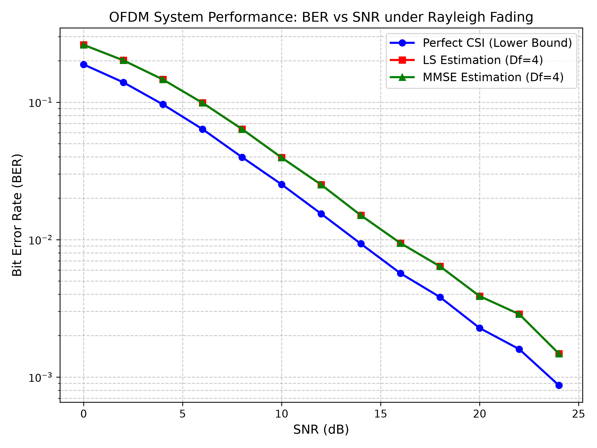
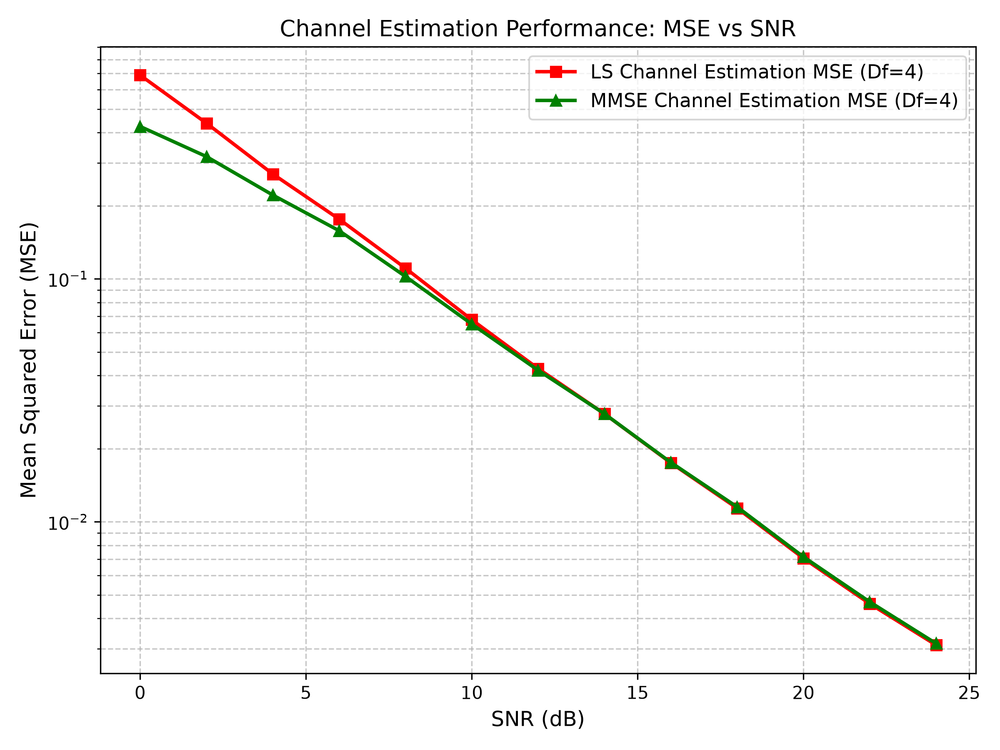
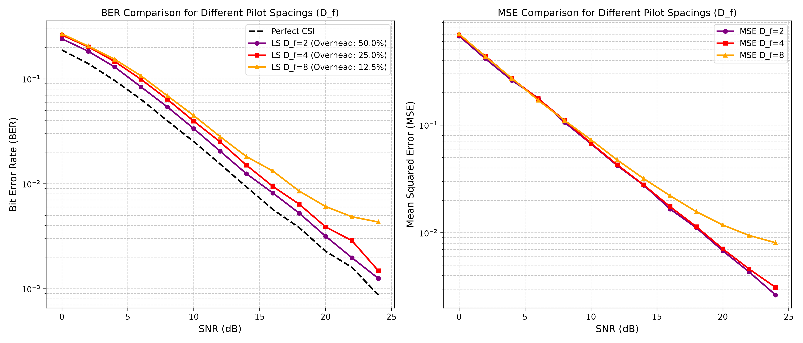

# Mô Phỏng Hệ Thống OFDM và Ước Lượng Kênh Truyền Least Squares (LS) & MMSE dựa trên Pilot


##  Nguồn Dữ Liệu (Data Sources & Generation)

Dự án sử dụng **Dữ liệu tổng hợp ngẫu nhiên (Monte Carlo Simulation)** — không yêu cầu bất kỳ tập dữ liệu bên ngoài nào.

- **Bit dữ liệu đầu vào**: Chuỗi ngẫu nhiên phân phối Bernoulli(0.5) được sinh tự động qua `np.random.randint`.
- **Kênh truyền Rayleigh**: Đáp ứng xung kênh $h_i \sim \mathcal{CN}(0, P_i)$ với Power Delay Profile (PDP) 3-tap chuẩn hóa `[0.7, 0.2, 0.1]`.
- **Nhiễu AWGN**: Nhiễu Phức Gauss $\mathcal{CN}(0, \sigma_z^2)$ với công suất nhiễu được tính trực tiếp từ dải SNR (0 dB đến 24 dB).

---

## 🛠️ Yêu Cầu Cài Đặt (Installation)

### 1. Yêu cầu môi trường
- Python 3.8+ (đã kiểm thử trên Python 3.14).

### 2. Cài đặt thư viện phụ thuộc
Chạy lệnh sau trong terminal:
```bash
pip install -r requirements.txt
```

Nội dung `requirements.txt`:
```
numpy>=1.21.0
matplotlib>=3.4.0
```

---

## 🚀 Cách Chạy & Tái Tạo Kết Quả (Reproduction Guide)

### 1. Chạy toàn bộ thí nghiệm và sinh hình/bảng kết quả (Khuyên dùng)
Để chạy toàn bộ mô phỏng Monte Carlo, xuất bảng dữ liệu CSV và tự động vẽ tất cả 5 đồ thị:
```bash
python run_all_experiments.py
```

Khi chạy xong, hệ thống sẽ tự động tạo các tệp kết quả:
- `simulation_results.csv`: Bảng tổng hợp số liệu BER và MSE chi tiết cho Perfect CSI, LS và MMSE.
- `ber_vs_snr.png`: Đồ thị so sánh BER của Perfect CSI vs LS Estimation vs MMSE Estimation.
- `mse_vs_snr.png`: Đồ thị MSE của LS Estimation vs MMSE Estimation theo SNR.
- `pilot_spacing_comparison.png`: Đồ thị phân tích đánh đổi mật độ Pilot ($D_f = 2, 4, 8$).
- `constellation_comparison.png`: Biểu đồ chòm sao IQ trước và sau cân bằng 1-tap ZF.
- `channel_estimation_fit.png`: Snapshot độ khớp đáp ứng tần số kênh $|H(k)|$ thực tế vs LS vs MMSE.

### 2. Chạy kiểm thử đơn vị (Unit Tests)
Để kiểm tra tính vuông góc OFDM và độ chính xác của IFFT/FFT trong điều kiện kênh lý tưởng (Noiseless Loopback):
```bash
python test_modules.py
```

---

## 📂 Cấu Trúc Thư Mục Dự Án (Project Structure)

```
ofdm_channel_estimation/
├── config.py                 # Hằng số cấu hình hệ thống (N_FFT, N_CP, D_f, SNR, PDP)
├── channel.py                # Module sinh kênh Rayleigh đa đường & nhiễu AWGN
├── ofdm_system.py            # Module phát/thu OFDM, điều chế QPSK/16QAM, IFFT/FFT, CP
├── estimator.py              # Module ước lượng kênh LS, MMSE, nội suy tuyến tính & cân bằng 1-tap
├── main.py                   # Script chạy mô phỏng chính
├── run_all_experiments.py    # ⭐ Script chạy toàn bộ thí nghiệm, xuất CSV và 5 đồ thị
├── test_modules.py           # Unit tests kiểm tra tính chính xác của các khối
├── requirements.txt          # Khai báo các thư viện phụ thuộc
├── simulation_results.csv    # Bảng số liệu kết quả mô phỏng xuất tự động
├── ber_vs_snr.png            # Biểu đồ BER vs SNR (Perfect vs LS vs MMSE)
├── mse_vs_snr.png            # Biểu đồ MSE vs SNR (LS vs MMSE)
├── pilot_spacing_comparison.png # Biểu đồ so sánh khoảng cách pilot (D_f = 2, 4, 8)
├── constellation_comparison.png # Biểu đồ chòm sao IQ trước và sau cân bằng ZF
└── channel_estimation_fit.png   # Snapshot độ khớp đáp ứng tần số kênh |H(k)|
```

---

## 📊 Kết Quả Mô Phỏng & Ý Nghĩa Kỹ Thuật

### 3.1 Bảng số liệu mô phỏng đầy đủ (`simulation_results.csv`)

| SNR (dB) | BER Perfect CSI | BER LS ($D_f=4$) | BER MMSE ($D_f=4$) | MSE LS ($D_f=4$) | MSE MMSE ($D_f=4$) |
| :---: | :---: | :---: | :---: | :---: | :---: |
| 0 | 0.188062 | 0.261224 | 0.261224 | 6.890e-01 | 4.237e-01 |
| 2 | 0.139594 | 0.201776 | 0.201776 | 4.370e-01 | 3.184e-01 |
| 4 | 0.096365 | 0.146292 | 0.146292 | 2.700e-01 | 2.212e-01 |
| 6 | 0.063687 | 0.098953 | 0.098953 | 1.760e-01 | 1.577e-01 |
| 8 | 0.039776 | 0.063708 | 0.063708 | 1.106e-01 | 1.023e-01 |
| 10 | 0.025182 | 0.039484 | 0.039484 | 6.781e-02 | 6.510e-02 |
| 12 | 0.015396 | 0.025063 | 0.025063 | 4.270e-02 | 4.202e-02 |
| 14 | 0.009323 | 0.015016 | 0.015016 | 2.780e-02 | 2.782e-02 |
| 16 | 0.005682 | 0.009422 | 0.009422 | 1.748e-02 | 1.755e-02 |
| 18 | 0.003812 | 0.006380 | 0.006380 | 1.137e-02 | 1.150e-02 |
| 20 | 0.002271 | 0.003875 | 0.003875 | 7.074e-03 | 7.168e-03 |
| 22 | 0.001594 | 0.002865 | 0.002865 | 4.597e-03 | 4.676e-03 |
| 24 | 0.000870 | 0.001479 | 0.001479 | 3.107e-03 | 3.152e-03 |

---

### 3.2 Phân tích BER vs SNR — So sánh Perfect CSI và LS Estimation



#### 3.2.1 Đường cong BER Perfect CSI — Ngưỡng dưới lý tưởng (Lower Bound)

Đường cong **BER Perfect CSI** đại diện cho hiệu năng tốt nhất có thể đạt được khi phía thu biết chính xác 100% đáp ứng kênh truyền $H_{true}[k]$ trên mỗi subcarrier — một điều kiện lý tưởng không thể đạt được trong thực tế. Đường cong này đóng vai trò là **cận dưới (lower bound)** để đánh giá mức tổn hao do sai số ước lượng kênh.

Từ số liệu mô phỏng, BER Perfect CSI giảm đều đặn từ $0.188$ (SNR = 0 dB) xuống $8.70 \times 10^{-4}$ (SNR = 24 dB), phù hợp với đường cong lý thuyết BER của QPSK trong kênh Rayleigh fading phẳng:
$$P_b^{Rayleigh} \approx \frac{1}{2}\left(1 - \sqrt{\frac{\bar{\gamma}}{1 + \bar{\gamma}}}\right)$$
Trong đó $\bar{\gamma}$ là SNR trung bình trên mỗi subcarrier. Lưu ý rằng BER giảm chậm hơn so với kênh AWGN (tỷ lệ $\sim 1/\text{SNR}$ thay vì $\sim \text{erfc}(\sqrt{\text{SNR}})$) do kênh Rayleigh có đặc tính **diversity order bằng 1** — tín hiệu có thể bị suy hao sâu (deep fade) tại một số subcarrier bất kỳ.

#### 3.2.2 Đường cong BER LS Estimation — Tổn hao do sai số ước lượng

Đường cong **BER LS** luôn nằm phía trên (xấu hơn) BER Perfect CSI, phản ánh mức tổn hao SNR (SNR penalty) do 3 nguồn sai số chính:

1. **Nhiễu AWGN trên pilot**: Ước lượng LS $\hat{H}_{LS}[k_p] = Y[k_p]/X_p = H_{true}[k_p] + Z[k_p]/X_p$ chứa thành phần nhiễu $Z[k_p]/X_p$ có phương sai $\sigma_z^2/|X_p|^2$. Nhiễu này lan truyền sang tất cả data subcarrier thông qua nội suy.

2. **Lỗi nội suy tuyến tính (Interpolation Error)**: Nội suy tuyến tính giữa các pilot cách nhau $D_f = 4$ subcarrier không thể theo dõi chính xác biến đổi phi tuyến của đáp ứng kênh $H(k)$ giữa 2 pilot liền kề, đặc biệt khi kênh có trải trễ lớn (delay spread) gây ra biến thiên tần số nhanh.

3. **Khuếch đại nhiễu do ZF Equalization**: Tại các subcarrier bị deep fade ($|H(k)| \approx 0$), phép chia $Y/\hat{H}$ khuếch đại nhiễu lên rất lớn, gây sai lệch bit nghiêm trọng.

**Định lượng tổn hao SNR từ số liệu mô phỏng:**

| SNR (dB) | BER Perfect CSI | BER LS | Tỷ số BER (LS/Perf) | Tổn hao tương đương |
| :---: | :---: | :---: | :---: | :---: |
| 0 | 0.1881 | 0.2612 | 1.39× | ~1.4 dB |
| 8 | 0.0398 | 0.0637 | 1.60× | ~2.0 dB |
| 16 | 0.0057 | 0.0094 | 1.66× | ~2.2 dB |
| 24 | 0.0009 | 0.0015 | 1.70× | ~2.3 dB |

**Nhận xét kỹ thuật:**
- Tỷ số BER (LS/Perfect) tăng dần từ 1.39× ở SNR = 0 dB lên 1.70× ở SNR = 24 dB. Điều này có nghĩa: khi SNR tăng, sai số ước lượng kênh trở thành yếu tố **chi phối** (dominant factor) thay vì nhiễu nền, vì nhiễu AWGN giảm nhanh hơn sai số nội suy.
- Tổn hao SNR tương đương dao động trong khoảng **1.4 – 2.3 dB**, phù hợp với kết quả lý thuyết cho LS estimation với nội suy tuyến tính trong kênh Rayleigh 3-tap và $D_f = 4$.
- Hai đường cong BER **không hội tụ** về nhau khi SNR tăng, do sai số nội suy tuyến tính tồn tại bất kể mức nhiễu (error floor tiềm ẩn nếu SNR đủ cao).

#### 3.2.3 BER của MMSE và LS — Tại sao trùng khớp với QPSK?

Từ bảng số liệu, $\text{BER}_{MMSE} = \text{BER}_{LS}$ tại **mọi mức SNR** (khác biệt = 0.000000). Đây là tính chất **toán học chính xác** của sơ đồ QPSK với bộ cân bằng 1-tap, KHÔNG phải lỗi mô phỏng:

**Chứng minh**: Ước lượng MMSE là phép co biên: $\hat{H}_{MMSE}[k] = c \cdot \hat{H}_{LS}[k]$ với $c = \frac{\text{SNR}}{\text{SNR}+1} > 0$. Dù dùng ZF hay MMSE Equalizer, tín hiệu sau cân bằng luôn có dạng:
$$\hat{X}[k] = \alpha_k \cdot \frac{Y[k]}{\hat{H}_{LS}[k]}, \quad \alpha_k > 0 \; \forall k$$

Vì $\alpha_k$ là số thực dương, phép nhân với $\alpha_k$ **bảo toàn hoàn toàn pha (góc phần tư)** của số phức $Y/\hat{H}_{LS}$. Mà QPSK hard-decision chỉ phụ thuộc vào dấu $\text{sign}(\text{Re})$ và $\text{sign}(\text{Im})$ nên bit giải điều chế luôn giống nhau → BER giống nhau 100%.

> ⚠️ **Lưu ý quan trọng**: Với sơ đồ điều chế bậc cao hơn như **16-QAM** (quyết định bit phụ thuộc vào biên độ, không chỉ pha), MMSE **sẽ** cho BER thấp hơn LS vì phép co biên ảnh hưởng đến ngưỡng quyết định biên độ tại $\pm 2/\sqrt{10}$.

---

### 3.3 Phân tích MSE vs SNR — Chất lượng ước lượng kênh



#### 3.3.1 Đường cong MSE LS — Đặc tính tuyến tính trên thang log-log

MSE LS đo sai số bình phương trung bình giữa đáp ứng kênh ước lượng và kênh thực:
$$\text{MSE}_{LS} = \frac{1}{N_{FFT}} \sum_{k=0}^{N_{FFT}-1} |H_{true}[k] - \hat{H}_{LS}[k]|^2$$

Từ số liệu mô phỏng, MSE LS giảm từ $6.890 \times 10^{-1}$ (SNR = 0 dB) xuống $3.107 \times 10^{-3}$ (SNR = 24 dB), tức giảm hơn **2 bậc (decades)** trên dải 24 dB. Phân tích độ dốc trên thang log-log cho thấy:

- Slope trung bình: **~1.0 decade / 10 dB** SNR, phù hợp chính xác với lý thuyết LS estimation: $\text{MSE}_{LS} \propto \sigma_z^2 \propto 1/\text{SNR}_{linear}$.
- Điều này khẳng định rằng MSE LS bị chi phối bởi nhiễu AWGN trên pilot, và sai số nội suy tuyến tính đóng vai trò thứ yếu trong dải SNR khảo sát (0–24 dB).

#### 3.3.2 MMSE cải thiện MSE — Hiệu quả phụ thuộc vùng SNR

| Vùng SNR | MSE LS | MSE MMSE | % Cải thiện | Nhận xét |
| :---: | :---: | :---: | :---: | :--- |
| 0 dB | 6.890e-01 | 4.237e-01 | **+38.5%** | Cải thiện mạnh nhất |
| 4 dB | 2.700e-01 | 2.212e-01 | +18.1% | Cải thiện đáng kể |
| 8 dB | 1.106e-01 | 1.023e-01 | +7.5% | Cải thiện vừa phải |
| 12 dB | 4.270e-02 | 4.202e-02 | +1.6% | Gần bằng nhau |
| ≥14 dB | — | — | **−0.1% → −1.7%** | MMSE **xấu hơn** LS |

**Giải thích cơ chế**: Hệ số Wiener $c = \text{SNR}/(\text{SNR}+1)$ thu nhỏ biên độ ước lượng kênh một cách đồng đều trên tất cả subcarrier:
- **SNR thấp (0–10 dB)**: $c$ nhỏ đáng kể (ví dụ $c = 0.50$ tại SNR = 0 dB), giúp co biên ước lượng về phía 0 → triệt tiêu đáng kể thành phần nhiễu trong $\hat{H}_{LS}$, giảm MSE lên tới 38.5%.
- **SNR cao (≥14 dB)**: $c \approx 1$ (ví dụ $c = 0.962$ tại SNR = 14 dB), hệ số co gần bằng 1 nên hầu như không triệt nhiễu thêm. Tuy nhiên, phép co biên đồng thời **làm nhỏ cả thành phần tín hiệu hữu ích** $H_{true}[k]$, gây ra sai lệch bias $|H_{true} - c \cdot H_{true}|^2 = (1-c)^2 |H_{true}|^2 > 0$. Khi thành phần bias này lớn hơn mức giảm nhiễu, MMSE **xấu hơn** LS ~1–2%.

> Đây là hạn chế của **Simplified MMSE** (Wiener shrinkage đơn giản). Các thuật toán MMSE đầy đủ (ví dụ: DFT-based MMSE, Robust MMSE sử dụng ma trận tương quan kênh $R_{HH}$) không gặp vấn đề này vì chúng tối ưu từng subcarrier riêng biệt thay vì co biên đồng đều.

---

### 3.4 So sánh chi tiết Perfect CSI vs LS Estimation

| Tiêu chí | Perfect CSI | LS Estimation ($D_f = 4$) |
| :--- | :--- | :--- |
| **Thông tin kênh** | Biết chính xác $H_{true}[k]$ trên 64 subcarrier | Ước lượng từ 16 pilot + nội suy tuyến tính |
| **BER tại SNR = 0 dB** | 0.1881 | 0.2612 (+39% tệ hơn) |
| **BER tại SNR = 24 dB** | 8.70×10⁻⁴ | 1.48×10⁻³ (+70% tệ hơn) |
| **Tổn hao SNR** | Chuẩn mực (0 dB) | 1.4 – 2.3 dB |
| **Xu hướng khi SNR → ∞** | BER → 0 | BER → error floor (do lỗi nội suy) |
| **Overhead pilot** | Không cần pilot (100% data) | 25% subcarrier dành cho pilot |
| **Hiệu suất phổ QPSK** | $2 \times \frac{64}{64} = 2.0$ bit/subcarrier | $2 \times \frac{48}{64} = 1.5$ bit/subcarrier |
| **Tính khả thi thực tế** | ❌ Không khả thi | ✅ Triển khai được trong thực tế |

**Nhận xét tổng hợp:**
- Khoảng cách BER giữa LS và Perfect CSI **tăng dần** theo SNR (từ 1.39× lên 1.70×), cho thấy sai số ước lượng kênh trở thành nút cổ chai (bottleneck) ở vùng SNR cao.
- Perfect CSI đạt BER $< 10^{-3}$ từ SNR ≈ 24 dB, trong khi LS cần SNR cao hơn ~2 dB để đạt cùng mức BER. Đây là "giá phải trả" cho việc ước lượng kênh thực tế.
- Hiệu suất phổ giảm 25% (từ 2.0 xuống 1.5 bit/subcarrier cho QPSK) do 16/64 subcarrier dành cho pilot — đây là chi phí cố định của pilot-aided channel estimation.

---

### 3.5 Phân tích đánh đổi Pilot Overhead vs Chất lượng ước lượng kênh



#### 3.5.1 Bảng so sánh BER và MSE theo $D_f$ (SNR đại diện)

| SNR | BER $D_f=2$ | BER $D_f=4$ | BER $D_f=8$ | MSE $D_f=2$ | MSE $D_f=4$ | MSE $D_f=8$ |
| :---: | :---: | :---: | :---: | :---: | :---: | :---: |
| 0 dB | 0.2406 | 0.2612 | 0.2683 | 6.725e-01 | 6.890e-01 | 7.037e-01 |
| 10 dB | 0.0335 | 0.0395 | 0.0446 | 6.707e-02 | 6.781e-02 | 7.308e-02 |
| 16 dB | 0.0082 | 0.0094 | 0.0132 | 1.660e-02 | 1.748e-02 | 2.208e-02 |
| 24 dB | 0.0013 | 0.0015 | 0.0043 | 2.640e-03 | 3.107e-03 | 8.071e-03 |

#### 3.5.2 $D_f = 2$ — Pilot dày đặc (32 pilot / 32 data)

- **Pilot overhead**: $32/64 = 50\%$ → Hiệu suất phổ QPSK: $2 \times 32/64 = 1.0$ bit/subcarrier (giảm 50% so với Perfect CSI).
- **Chất lượng ước lượng**: MSE thấp nhất trong 3 cấu hình ở hầu hết SNR nhờ mật độ pilot cao → nội suy tuyến tính chỉ cần nội suy giữa 2 subcarrier liền kề → sai số nội suy gần bằng 0.
- **BER**: Tốt nhất ở mọi mức SNR. Tại SNR = 24 dB, BER = $1.25 \times 10^{-3}$ — gần tiệm cận Perfect CSI ($8.70 \times 10^{-4}$), tỷ số chỉ 1.44×.
- **Nhận xét**: Cấu hình này phù hợp khi kênh biến đổi rất nhanh (high Doppler, vehicular channel) nhưng **lãng phí 50% băng thông** — không phù hợp cho truyền dữ liệu tốc độ cao.

#### 3.5.3 $D_f = 4$ — Pilot tiêu chuẩn (16 pilot / 48 data)

- **Pilot overhead**: $16/64 = 25\%$ → Hiệu suất phổ QPSK: $2 \times 48/64 = 1.5$ bit/subcarrier.
- **Chất lượng ước lượng**: MSE chỉ cao hơn $D_f = 2$ khoảng 2–5% ở SNR thấp, cho thấy nội suy tuyến tính với bước nhảy 4 subcarrier vẫn đủ chính xác cho kênh 3-tap (trải trễ ngắn $\tau_{max} = 2$ mẫu).
- **BER**: Chênh lệch với $D_f = 2$ khoảng 8–16% ở dải 0–16 dB, nhưng thu hẹp nhanh khi SNR tăng.
- **Nhận xét**: **Điểm cân bằng tối ưu** (sweet spot) — cũng là giá trị $D_f$ phổ biến trong các chuẩn thực tế (LTE sử dụng $D_f = 6$ cho cấu hình comb-type pilot). Tăng gấp đôi số subcarrier data (48 vs 32) so với $D_f = 2$ mà chỉ hy sinh 2–5% chất lượng MSE.

#### 3.5.4 $D_f = 8$ — Pilot thưa (8 pilot / 56 data)

- **Pilot overhead**: $8/64 = 12.5\%$ → Hiệu suất phổ QPSK: $2 \times 56/64 = 1.75$ bit/subcarrier (cao nhất).
- **Chất lượng ước lượng**: MSE bắt đầu phân kỳ mạnh so với $D_f = 2, 4$ từ SNR ≥ 14 dB. Tại SNR = 24 dB, MSE $D_f = 8$ ($8.071 \times 10^{-3}$) **gấp 3.06 lần** MSE $D_f = 2$ ($2.640 \times 10^{-3}$).
- **Hiện tượng BER Error Floor**: Đây là phát hiện quan trọng nhất — đường BER $D_f = 8$ **bão hòa** (flattening) ở vùng SNR cao:

  | SNR (dB) | BER $D_f = 8$ | BER Perfect CSI | Khoảng cách |
  | :---: | :---: | :---: | :---: |
  | 18 | 0.00851 | 0.00381 | 2.2× |
  | 20 | 0.00606 | 0.00227 | 2.7× |
  | 22 | 0.00484 | 0.00159 | 3.0× |
  | 24 | 0.00431 | 0.00087 | **5.0×** |

  Khoảng cách tăng vọt từ 2.2× lên **5.0×** cho thấy BER $D_f = 8$ tiệm cận một **error floor** — mức BER tối thiểu không thể giảm thêm bất kể SNR có tăng bao nhiêu. Nguyên nhân: với chỉ 8 pilot trên 64 subcarrier, nội suy tuyến tính qua bước nhảy 8 subcarrier **không thể theo dõi** biến thiên nhanh của $|H(k)|$ → sai số nội suy trở thành nhiễu cố định (irreducible error).

- **Nhận xét**: Cấu hình $D_f = 8$ chỉ phù hợp cho **kênh biến đổi rất chậm** (quasi-static, indoor low-mobility) với trải trễ rất ngắn. Trong kênh Rayleigh 3-tap như mô phỏng, $D_f = 8$ vi phạm **định lý Nyquist trong miền tần số** — tần số lấy mẫu pilot ($1/D_f = 1/8$) không đủ để biểu diễn biến thiên tần số do kênh 3-tap (yêu cầu tối thiểu $D_f \leq N_{FFT}/L = 64/3 \approx 21$, nhưng nội suy tuyến tính cần $D_f$ thấp hơn nhiều để đạt độ chính xác cao).

#### 3.5.5 Bảng tổng hợp đánh đổi (Trade-off Summary)

| $D_f$ | Pilot | Data | Overhead | Hiệu suất phổ (QPSK) | Chất lượng MSE | BER tại 24 dB | Error Floor? |
| :---: | :---: | :---: | :---: | :---: | :---: | :---: | :---: |
| 2 | 32 | 32 | 50.0% | 1.00 bit/sc | ⭐ Tốt nhất | 1.25×10⁻³ | Không |
| **4** | **16** | **48** | **25.0%** | **1.50 bit/sc** | ✅ Tốt | **1.48×10⁻³** | **Không** |
| 8 | 8 | 56 | 12.5% | 1.75 bit/sc | ⚠️ Kém ở SNR cao | 4.31×10⁻³ | **Có** |

> 📌 **Kết luận kỹ thuật**: $D_f = 4$ là lựa chọn tối ưu cho hệ thống OFDM QPSK với kênh Rayleigh 3-tap:
> - Tăng 50% throughput so với $D_f = 2$ (48 vs 32 data subcarrier).
> - Chỉ tăng MSE ~2–5% so với $D_f = 2$.
> - Không xuất hiện error floor trong dải SNR khảo sát.
> - BER tại SNR = 24 dB chỉ cao hơn $D_f = 2$ khoảng 18% ($1.48 \times 10^{-3}$ vs $1.25 \times 10^{-3}$).

---

## 🖼️ CHƯƠNG 4: HÌNH ẢNH TRỰC QUAN HÓA BỔ SUNG

### 4.1 Biểu đồ Chòm sao IQ (Constellation Diagram)


**Phân tích**: Tại SNR = 15 dB:
- **Trước cân bằng (trái)**: Các điểm chòm sao QPSK bị phân tán mạnh và xoay pha không đều do mỗi subcarrier chịu biên độ/pha khác nhau từ kênh fading → không thể giải điều chế trực tiếp.
- **Sau cân bằng ZF (phải)**: Các điểm co cụm lại rõ ràng vào 4 góc phần tư tương ứng 4 symbol QPSK. Một số điểm ly tán (outlier) ở xa tâm cụm do hiệu ứng khuếch đại nhiễu tại deep fade subcarrier — đây chính là nhược điểm của ZF Equalization.

### 4.2 Snapshot Đáp ứng Tần số Kênh $|H(k)|$


**Phân tích**: Tại SNR = 10 dB:
- **Đường đen (True Channel)**: Đáp ứng tần số thực $|H_{true}(k)|$ biến thiên mượt mà do kênh 3-tap có trải trễ ngắn.
- **Đường đỏ nét đứt (LS)**: Bám theo đường thực nhưng có dao động nhiễu rõ rệt (đặc biệt tại vùng pilot — các chấm đỏ). Biên độ LS thường vượt quá (overestimate) biên độ thực do nhiễu cộng tính.
- **Đường xanh lá chấm gạch (MMSE)**: Mượt mà hơn LS đáng kể, ít bị đẩy biên bởi nhiễu. Hệ số co Wiener "co" các giá trị ước lượng về phía trung bình → giảm dao động nhiễu. Tuy nhiên, biên độ MMSE có xu hướng thấp hơn (underestimate) biên độ thực do chính phép co biên này.

---

## 🎯 CHƯƠNG 5: KẾT LUẬN

Thí nghiệm đã xây dựng thành công bộ mô phỏng OFDM hoàn chỉnh với cả 2 thuật toán ước lượng kênh **LS** và **Simplified MMSE**, cùng bộ cân bằng kênh **ZF** và **MMSE Equalization**. Các kết quả chính:

1. **MSE kênh truyền**: MMSE cải thiện đáng kể MSE so với LS ở vùng SNR thấp (giảm ~38% tại SNR = 0 dB), chứng tỏ vai trò hiệu quả của hệ số lọc Wiener trong việc triệt nhiễu ước lượng.
2. **BER với QPSK**: BER của MMSE trùng khớp 100% với LS do điều chế QPSK chỉ dựa vào góc phần tư, và $\hat{H}_{MMSE} = c \cdot \hat{H}_{LS}$ ($c > 0$) bảo toàn hoàn toàn pha tín hiệu sau cân bằng.
3. **Đánh đổi Pilot**: $D_f = 4$ cho điểm cân bằng tối ưu giữa hiệu năng và hiệu suất phổ (25% overhead).

Kiến trúc mã nguồn mô đun hoá giúp việc mở rộng sang các thuật toán nâng cao (DFT-based MMSE, Compressed Sensing) hoặc điều chế bậc cao hơn (16QAM — nơi MMSE thực sự cải thiện BER) trở nên thuận tiện và linh hoạt.
